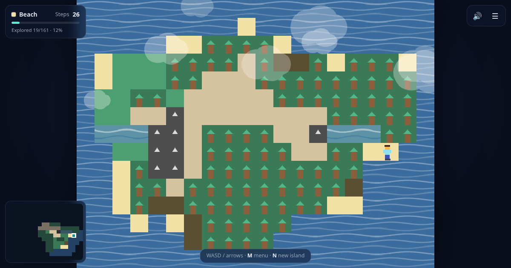
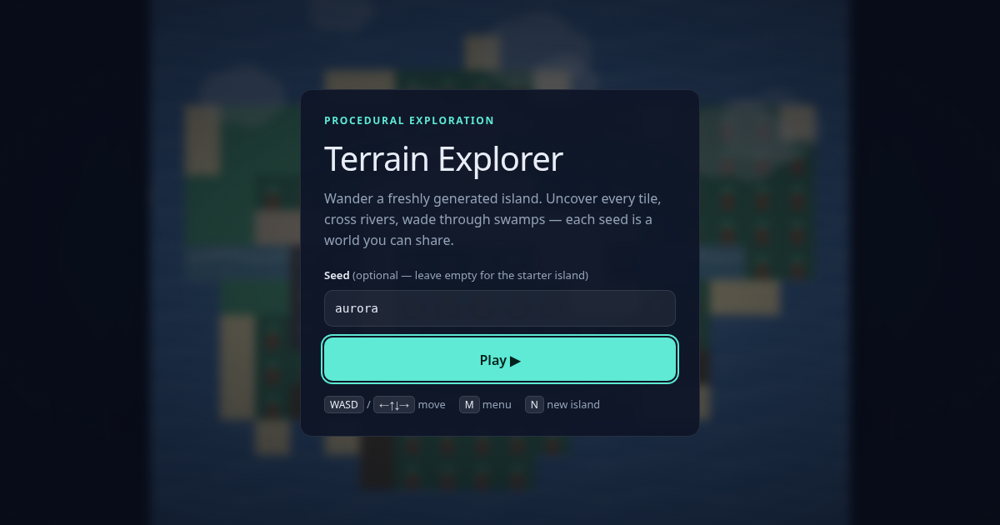
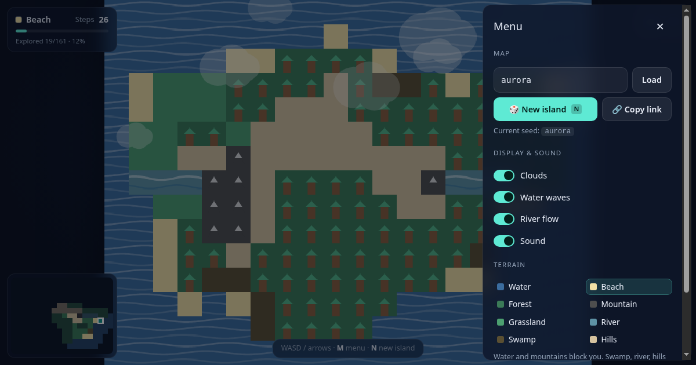
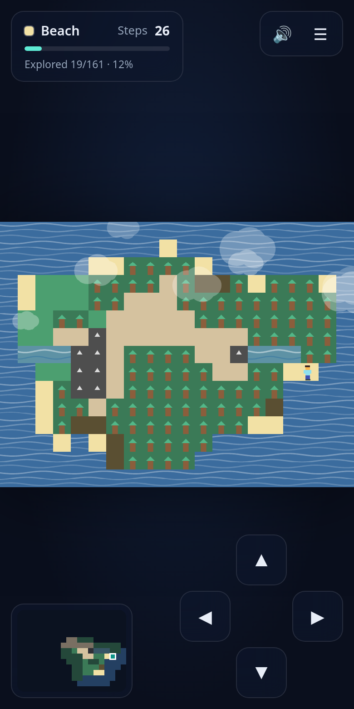

# Terrain Explorer — Simple Pixel Game

A pixel-art exploration game built with **SvelteKit 2, Svelte 5, TypeScript and Web Workers**. Every island is
procedurally generated from a seed, so any map can be shared with a link. Walk it, uncover every tile, and watch
the fog-of-war mini-map fill in.



<p align="center">
  
  
</p>
<p align="center">
  
</p>

## Features

- 🗺 **Procedural islands** – seeded generation (beaches, forests, swamps, hills, mountains, rivers). The same seed
  always yields the same map, and every walkable tile is guaranteed to be reachable.
- 🔗 **Shareable maps** – the active seed lives in the URL (`?seed=aurora`); the menu has a *Copy link* button.
- 🖥 **Full-screen minimal UI** – glass HUD, title screen, slide-in menu, toast messages, responsive on desktop and phones.
- 🧭 **Exploration progress** – step counter and explored-tiles progress bar, plus a **fog-of-war mini-map**.
- 🐢 **Terrain movement cost** – swamp, river, hills and forest slow you down; water and mountains block you.
- 🎞 **Smooth animation** – eased tile-to-tile movement with a walk cycle, flowing river, rolling waves, drifting
  clouds, and a discovery "pop" on newly explored tiles.
- 🔊 **Synthesised audio** – terrain-aware footsteps, bump, discovery chime, new-map jingle and ambient waves.
  Generated with WebAudio, so there are no audio files; mute any time.
- 📱 **Touch controls** – on-screen D-pad (hold to keep walking) appears automatically on touch devices.
- 🛠 **Developer info** – FPS, heap usage, worker status and game-state viewer, tucked into the menu.
- ♿ Keyboard-accessible menus, focus management and `prefers-reduced-motion` support.

## Controls

| Input | Action |
|---|---|
| `W A S D` / arrow keys | Move |
| On-screen D-pad (touch) | Move; hold to keep walking |
| `M` or `Esc` | Open / close the menu |
| `N` | Generate a new random island |

Menu: load a seed, new island, copy link, toggle clouds / waves / river / sound, terrain legend, developer info.
Animation and sound preferences are remembered in your browser.

## Terrain

| Tile | Name | Behaviour |
|---|---|---|
| W | Water | Impassable |
| M | Mountain | Impassable |
| B | Beach | Normal speed |
| G | Grassland | Normal speed |
| F | Forest | Slightly slower (×1.2) |
| H | Hills | Slower (×1.3) |
| R | River | Slower (×1.5) |
| S | Swamp | Slowest (×2) |

## How it works

```
Main thread (Game.ts)                         Web Worker (worker.ts)
─────────────────────                         ──────────────────────
input, rendering, tweening, effects  ──msg──▶  map, rules, movement, stats
canvas + Svelte UI                   ◀─msg──   new state / terrain map
```

- **Worker** owns the authoritative game state: terrain map, collision, steps and explored tiles. Messages:
  `START`, `GAME_UPDATE` (move) and `GENERATE` (new seeded map).
- **Game** (main thread) sends moves, eases the sprite between tiles, draws the canvas at a fixed 800×600 logical
  size (CSS scales it, pixelated), and emits gameplay events (`step`, `blocked`, `discover`, `mapreset`) that the UI
  turns into sound, toasts and transitions.
- **Map generation** (`mapgen.ts`) – seeded PRNG → two layers of value noise (elevation, moisture) with an island
  falloff → terrain classification → rivers that run downhill to the sea → keep only the largest connected walkable
  region → pick a central start tile.
- Idle states (active → resting → idle → sleeping) lower the frame rate to save power, but never below 30 fps while
  animations are on.

## Project structure

```
src/
├── lib/
│   ├── audio.ts                 # WebAudio sound effects + ambience
│   ├── theme.ts / types.ts      # Theme, terrain data, shared types and message constants
│   ├── components/
│   │   ├── Hud.svelte           # Stats chip, mute and menu buttons
│   │   ├── MiniMap.svelte       # Fog-of-war mini-map
│   │   ├── DPad.svelte          # Touch D-pad
│   │   ├── TitleScreen.svelte   # Start screen with optional seed
│   │   ├── MenuPanel.svelte     # Map / display / sound / legend / dev info
│   │   └── DebugPanel.svelte    # Performance and state readout
│   ├── game/
│   │   ├── Game.ts              # Main-thread game: input, tween, render loop, events
│   │   ├── draw.ts              # Canvas drawing (terrain, character, water, clouds, effects)
│   │   ├── mapgen.ts            # Seeded island generator (+ mapgen.test.ts)
│   │   └── state.ts             # Idle-state definitions
│   └── workers/worker.ts        # Game logic worker
└── routes/
    ├── +layout.svelte           # SEO / social meta tags
    └── +page.svelte             # Page: wires game, UI, audio and settings
```

## Development

Requires [Bun](https://bun.sh) (npm/pnpm also work).

```bash
bun install
bun run dev        # start the dev server
bun run check      # svelte-check / TypeScript
bun run test       # map generator tests (determinism, reachability, variety)
bun run build      # production build (Netlify adapter)
bun run preview    # serve the production build
```

## Credits and license

Built by [Zxce3](https://github.com/Zxce3). Released under the [MIT License](./LICENSE).
